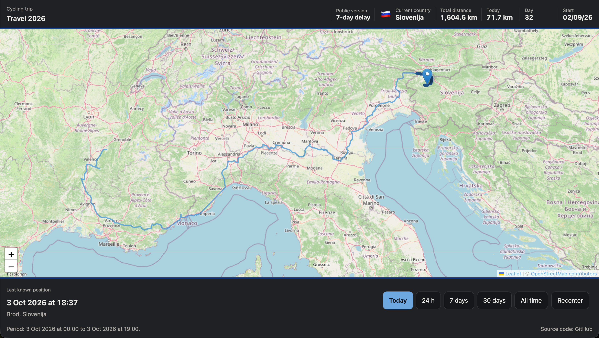

# Madhi Tracker

GPS tracking for a year-long cycling trip from France to the North Cape.

An Android phone records a location every five minutes, stores it locally, and
sends it to a private server whenever it has a network connection. The family
can follow the trip on a website protected by a secret URL path and a password.

## Status

| Component | Status |
|---|---|
| Android app | 1.0.3 (`versionCode 5`), functionally complete, including the map; awaiting field validation |
| Server | Deployed at `madhi-server.alexeber.fr`, with HTTPS, daily backups, and monitoring |
| Family website | Online at `madhi.alexeber.fr` since August 23, 2026, behind a secret URL path and a password |
| Public website | Online at `travel.alexeber.fr`, with a 168-hour publication delay |
| Installation guide | `site/installer.html`, served with the site, self-contained, and makes no outgoing requests |

The full pipeline, from phone to website, is in place, and the departure
procedure is documented in `arch/20_depart.md`. That does not mean the project
is ready: the app has **not yet** been validated in real-world conditions. It
still needs to pass the protocol in `arch/14_protocole_test_terrain.md` on the
target device, a Redmi Note 11, not the OnePlus used for pre-validation. This
is the project's only blocking issue.

One known issue remains unfixed: **the app does not restart tracking by itself
after the phone reboots.** This was observed on OxygenOS on August 23, 2026,
and cost twenty-four hours of tracking (`arch/15_journal_tests_terrain.md`,
session 5). MIUI is even more restrictive. The current instruction is clear:
**open the app once after every reboot and every APK update.** Since August 26,
the working theory has been that the “Auto-start in the background” setting
was never enabled for `com.madhi.tracker`; the issue may be a checkbox rather
than a bug.

## What it does

**On the phone.** The app opens to a map with the route and the age of the
latest location. The route is blue where the server has the points and orange
where they are still only on the phone. Four time ranges are available: today,
24 hours, 7 days, and the entire trip. The full route stays visible in light
blue beneath the selected range, so a day's ride never looks disconnected.
Tap a point on the route to see when and where it was recorded. The settings
are limited to the recording interval (three common choices plus “Other”) and
stopping tracking. Diagnostics, which can be read aloud by the phone, are
behind a button.

The “24 hours” range exists because “today” can be misleading at night: at
1 a.m., the calendar day shows only one hour of riding.

**On the family website.** A shorter version of the same screen: the latest
location and its age, the route for the selected range (today, 24 hours, 7
days, 30 days, or the entire trip), and a point tooltip on tap. The website
shows up to thirty days, while the app can show the entire trip: the app's
database is local to the phone, while the website depends on a server response.

**On the public website.** An English version of the route is published at
`travel.alexeber.fr` from exports containing only approved data, with a
168-hour delay. It offers the same time ranges as the family website. See
`tools/public-site/README.md` for publication and privacy details.

Neither website shows battery level or a real-time location. The functional
scope of the family website is described in `arch/06_site_V2.md`.

## Principles

**Offline first.** A location is written to the local database before any
network request. No code path deletes a point until the server confirms it:
not a timeout, an authentication error, or an unreadable response. An
architecture check fails if the domain layer starts depending on Android.

**Idempotency by identifier.** Each location gets a UUID when it is recorded.
The server inserts only identifiers it has not seen before and returns the
others as already stored. If a response is lost, the app can safely retry
without creating duplicates.

**No Big Tech services in the location data path.** No Google Play Services,
Firebase, analytics, or external crash reporting. Location is obtained through
the system `LocationManager` API, not the Fused Location Provider. Technical
logs cannot contain coordinates: the logging port's signature prevents it by
design. On the website, a `Content-Security-Policy` enforces the same boundary
in the browser; map tiles are the only exception.

**No direct requests to the geocoder from the phone or browser.** The address
shown in a point's tooltip is requested from the trip server, which relays the
request to Nominatim, spaces calls at least one second apart, and caches
responses. Neither the phone nor the family browser contacts the geocoder.
The relay is disabled by default, and the server refuses to start with it
enabled unless a reachable `User-Agent` identity is configured: Nominatim is
a shared resource.

**Repairable by one person.** One Gradle module, few dependencies, and no
infrastructure magic. The website has no build step: the files in the
repository are exactly the files being served.

**A map that works offline.** The home screen draws the route over raster map
tiles without a mapping library. The disk cache is checked **before** the
network, so an area viewed once remains available offline, which is the normal
mode during the trip.

The tile source is configured outside the repository, never in code. Without
that configuration, the map uses a plain background and makes no requests. A
self-hosted tile source, built by `tools/tiles` from public-domain data, remains
deployed as a fallback; it is the only source the project controls end to end
(ADR-006, `arch/18`).

## Architecture

Hexagonal architecture, with logical boundaries rather than separate Gradle
modules until the project needs them.

    presentation/     Compose, ViewModels
    adapter/input/    foreground service, receivers, worker
    application/      use cases and ports
    domain/           models and rules, without Android
    adapter/output/   Room, DataStore, OkHttp, LocationManager, AlarmManager
    infrastructure/   Hilt composition root, configuration, logging

The domain and use cases know nothing about Android, Room, or OkHttp. The
Gradle task `checkCoreIsFrameworkFree`, attached to `check`, fails if a
framework import appears there.

## Build

Requirements: JDK 17 or newer and the Android SDK.

    ./gradlew assembleDebug        # development APK
    ./gradlew assembleRelease      # trip APK, signed and minified by R8
    ./gradlew check                # tests and architecture checks

The tests run on the JVM, without an emulator or phone. Robolectric covers
Room and DataStore; the rest use simple fakes.

The release build **intentionally fails** if the API URL is not configured,
rather than producing an APK that points to a placeholder. It also fails if
signing materials are missing, so a release APK is never signed with the debug
key.

The release build is the one used on the trip (`arch/01` §2), so it is the one
that must pass field testing: R8 removes code that the debug build keeps.

## Configuration

No real values are committed. Copy the example files:

    cp local.properties.example local.properties
    cp keystore.properties.example keystore.properties

The environment variables `MADHI_API_BASE_URL_*`,
`MADHI_UPDATE_PAGE_URL_*`, and `ANDROID_SIGNING_*` take precedence over these
files, so they do not need to be created in CI.

## Releasing a version

Increment `versionCode` for every APK that is actually installed. Different
binaries must never share a name, or the retained `mapping.txt` file will no
longer match the APK.

Each release produces three files kept outside the repository (`dist/` is
ignored by git):

    dist/<version>/madhi-tracker-<version>.apk    the distributed APK
    dist/<version>/mapping-<version>.txt          the R8 mapping file
    dist/<version>/SHA256SUMS                     the APK's checksum

**Keep `mapping.txt`** under a versioned name outside the build directory. R8
renames everything; without the mapping file, a stack trace from the trip is
unreadable. `./gradlew clean` deletes the build copy without warning.

The APK is published as a GitHub *release*, under its versioned name and the
stable name `madhi-tracker-latest.apk`, which is used by
`site/mise_a_jour.html`. The installation guide can link directly to a
specific `.apk` file; Android starts the download automatically. The checksum
shown by the guide must be calculated from the **downloaded APK**, not a local
rebuild: two builds of the same code are not byte-for-byte identical, and a
mismatched checksum would be worse than no checksum.

The launcher icon is generated from `art/icone-source.jpeg`—an engraving of
Madhi—in three layers (foreground, background, and Android 13+ monochrome) and
five densities. The JPEG source is committed because the density variants
cannot be reproduced without it.

## Family website

The family website is in `site/`: static files with no build step, served by
an nginx container in the same stack as the server, behind a secret URL path
and a password. It contains no secret; the read token required by the API is
provided by the container, and the repository's `site/` directory is mounted
directly, with no intermediate copy.

    docker compose -f server/docker-compose.yml up -d   # the full stack
    python3 tools/site-dev/serve.py                     # site only, with mock data
    node tools/site-dev/verifier.mjs                    # checks without a browser

`site/installer.html` is served from the same mounted directory, so the
installation guide is also behind the secret path and family password. Keep
this in mind before sending the link to Madhi, who may not have that password.

Deployment to `madhi.alexeber.fr` and the follow-up checks are documented in
`site/README.md`.

## Server

FastAPI and PostgreSQL run in containers on a VPS. The server receives
locations, serves history to the website, and relays reverse geocoding.
Installation, environment variables, backups, and permission hardening are
documented in `SERVER_DEPLOYMENT.md`.

One fixed limitation is worth knowing: history is now **sampled**, not
truncated. The response used to stop at ten thousand points by dropping the
newest ones. After thirty-five days of travel, the website would have shown a
frozen last location with a green status (`arch/17` §4.1).

## Monitoring

Five checks run on the VPS every fifteen minutes—API, website, disk, backup
age, and age of the latest location—and send alerts to the phone. They exist
because a silent failure is costly: the backup script could fail for thirty
days without anyone knowing.

Alerts contain no coordinates. The location check reads `/status`, which
returns timestamps only, never `/latest-location`.

    sudo tools/monitoring/madhi-check.sh --dry-run
    sudo tools/monitoring/madhi-check.sh --test-alert

Two certificates expire during the trip: `madhi-server.alexeber.fr` on
November 17, 2026, and `madhi.alexeber.fr` on November 21. Monitoring does not
warn in advance; it turns red on the expiry date. Renewal must therefore be
verified before November (`arch/20` §7).

See `tools/monitoring/README.md`, and `SERVER_DEPLOYMENT.md` for how monitoring
fits into operations.

## Simulation server

The real server is deployed (see `SERVER_DEPLOYMENT.md`) and builds now target
it. The simulation server remains useful for offline development and serves
as an executable specification of idempotency.

    python3 tools/mock-server/server.py

See `tools/mock-server/README.md`.

## Documentation

Documents in `arch/` are the source of truth for functional requirements.
Technical decisions made along the way are in `arch/adr/`, using the
context / options / decision / consequences format.

The most useful documents for understanding the project:

- `arch/00_architecture_maitre.md` — shared contracts and change rules
- `arch/13_contrat_api_android_v1.md` — detailed API contract
- `arch/adr/002-execution-en-arriere-plan.md` — why a foreground service is
  not enough, and what complements it
- `arch/adr/007-contraintes-miui-redmi-note-11.md` — constraints imposed by
  the target phone's Android skin
- `arch/adr/008-cadence-par-le-flux-de-localisation.md` — why the location
  provider controls the recording interval
- `arch/14_protocole_test_terrain.md` — how to prove it works
- `arch/15_journal_tests_terrain.md` — what each device session showed,
  including what was lost
- `arch/17_plan_implementation_site_poc.md` — the website implementation plan
  and server pitfalls to know before building it
- `arch/18_carte_embarquee_v1.md` — how the embedded map works and how to
  change its tile source
- `arch/20_depart.md` — departure procedure in order: server, APK, Madhi's
  installation, verification, then the date the trip begins
- `site/README.md` — how to develop, deploy, and verify the family website
- `tools/monitoring/README.md` — what is monitored, what is not, and how to
  verify that alerts arrive

## License

Not yet decided.
